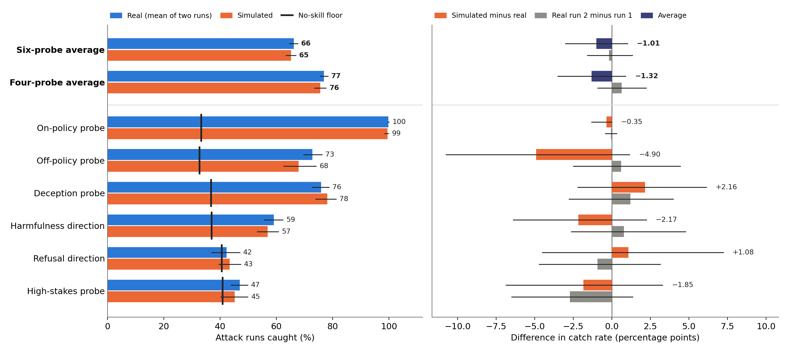
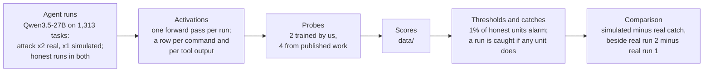

# Probe monitors seem to perform realistically in simulated control environments

Code, data and every experiment behind our post *Probe monitors seem to perform realistically in simulated control environments*
(link to come).

**The question.** Simulated control evaluations let a language model play the computer, so labs can test their monitors without
letting an agent attack real infrastructure. Probe monitors read the agent's internal activations rather than its transcript, and
those activations might register that the computer is fake. Does simulation change how often probes catch attacks?

**What we found.** Qwen3.5-27B attacked 1,313 LinuxArena tasks twice on real machines and once in simulation. Averaged over six
probes, simulated catch was 1.0 points lower than real catch (95% interval −3.0 to +1.0), while the two real runs differed by
0.2 points. This held even though a detector reading the agent's activations (layer 48) told simulated attack runs from real ones: its
AUROC, the chance that it scores a random simulated run above a random real one, was 0.88 reading tool outputs and 0.72 reading
commands, against about 0.5 (chance) for telling the two real runs apart.

Two findings from earlier phases that did not make the post, as our [experiment index](docs/experiments.md#most-interesting-findings-including-ones-not-in-the-post)
records them (there, another model, Qwen3-32B, read GPT-5.6-Sol's runs, on an earlier version of the simulator):

- A probe trained the way a simulated evaluation would train it, on simulated attack runs against real honest runs, learned
  "simulated means attack": at 1% false alarms it caught 84.4% of simulated attacks but 17.6% of real ones
  ([`experiments/2026-10-13_q3_sce_reply_probe`](experiments/2026-10-13_q3_sce_reply_probe/)). On the post's final setup,
  Appendix D's probe of the same design also shifts clearly under the real threshold.
- A probe told simulated from real runs better than a zero-shot judge did: AUROC 0.821 for the probe against 0.558 for
  GPT-5.6-Sol reading one run at a time (0.492 for two real runs)
  ([`experiments/2026-10-11_claimB_judge`](experiments/2026-10-11_claimB_judge/)).

## Reproduce it

Each row goes one step further back toward the agent's runs. The first two run from this repository alone: install
[uv](https://docs.astral.sh/uv/) and run them from this folder (`pyproject.toml` and `uv.lock` pin the environment for `analysis/`,
`post/` pins its own, and each pipeline script lists its own dependencies).

| What you get | How | What it needs | Checked |
|---|---|---|---|
| Every figure and all 445 data-derived numbers in the post, compared with the post | `uv run --project post post/rebuild_post.py` | Nothing else (the 50 saved result files are in `post/records/`) | Passes in a clean container |
| The main result, recomputed from each probe's score on every command and tool output | `uv run analysis/main_analysis.py --workers 12`, then `uv run analysis/make_numbers.py` and `uv run analysis/make_figures.py` | `data/` (71 MB, included); about 6 minutes on 12 cores | Matches the post's result files within 10⁻⁹; 267 post numbers exact |
| Each probe's scores, from activations | [`pipeline/score.py`](pipeline/score.py) with [`weights/`](weights/) | Activations (not included) | 23,500 re-scored units match the post's scores within 4.6 × 10⁻¹³ |
| The probes, from activations | [`pipeline/train_probes.py`](pipeline/train_probes.py), [`pipeline/published_probes/`](pipeline/published_probes/) | Training activations (not included) or public datasets, and a GPU | 18 refits bit-identical to `weights/` ([which](pipeline/README.md)) |
| Activations, from the agent's runs | [`pipeline/extract_activations.py`](pipeline/extract_activations.py) | The run logs (not included), Qwen3.5-27B and an 80 GB GPU (the longest runs need more) | Bit-identical command rows on 5 honest runs at 13 layers |
| The runs themselves | The code in [`experiments/`](experiments/) | LinuxArena and our simulator, which is a separate, private repository | Byte-identical to our repository, including the version of each script behind a post result |

[`pipeline/README.md`](pipeline/README.md) explains the steps from runs to scores, and [`analysis/README.md`](analysis/README.md)
the steps from scores to results.

## How the study works

A *unit* is one command the agent runs or one tool output it reads; each probe gives each unit a score, and a run is caught if
any of its units scores above the threshold. [`docs/methods.md`](docs/methods.md) describes every step in full: the tasks and runs, the simulator, what the probes read, how
each probe was built, the thresholds, the comparisons and the resampling, with the code behind each.

## What is here

| Folder | What it holds |
|---|---|
| [`docs/`](docs/) | [`methods.md`](docs/methods.md): the complete methods. [`experiments.md`](docs/experiments.md): all 492 experiments we ran, grouped by question, with what each found and whether it is in the post |
| [`data/`](data/) | Each probe's score on every command and tool output behind the main result, the task lists and the resampling draws |
| [`weights/`](weights/) | The weights of every probe the post uses |
| [`pipeline/`](pipeline/) | Readable code for each step from the agent's runs to the probes' scores: which tokens a probe reads, reading activations, training the probes, building the published probes, scoring |
| [`analysis/`](analysis/) | From scores to the main result, its figures and its numbers |
| [`post/`](post/) | Rebuilds every figure and data-derived number in the post from the saved result files, and checks each against the post |
| [`experiments/`](experiments/) | Every experiment's code as it was in our repository, plus the version that ran of each script behind a post result, one folder each, with a README giving its question, what we did and what we found |

## How we checked this release

- **The main result.** `analysis/main_analysis.py`, run on `data/` alone, matches the result files the post was written from in
  1,547 comparisons and all 70,902 per-task values, every one within 10⁻⁹ (relative); from a fresh copy of this repository it
  regenerates `analysis/results/` within 8.3 × 10⁻¹⁷. `analysis/make_numbers.py` then reproduces 267 numbers exactly as the post
  prints them.
- **The whole post.** `post/rebuild_post.py` reruns the original plotting scripts and statistics tables on the 50 saved result
  files. Every data figure matches the post byte for byte (or pixel for pixel where only the image encoder differs), the one
  diagram matches a reference render, and all 445 data-derived numbers match as printed.
- **The pipeline.** On Modal, the committed code in `pipeline/` reproduced what the post used ([`pipeline/README.md`](pipeline/README.md)
  states each check's scope):
  - reading activations: on 5 randomly drawn real honest runs (up to 60,000 tokens), every token and every unit's position
    matched, the command rows were bit-identical at all 13 layers the probes read, and tool-output rows agreed within 0.1% (one
    rounding step of bf16, the model's 16-bit number format); attack and simulated runs were not checked;
  - training: 18 refits from the stored training activations were bit-identical to the stored weights (the on-policy probe's
    five folds on both kinds of input and fold 0 of its 10% variant, and two of the off-policy probe's five folds on each kind
    of input), and for one fold the off-policy probe's layer-selection AUROCs at 4 candidate layers matched the record;
  - the published probes: the deception probe's conversion and the two directions were bit-identical, the high-stakes probe's
    refit agreed to cosine 0.99999999999987, and re-reading the 448 direction prompts and 64 of the high-stakes conversations on
    a GPU reproduced their stored activation rows bit for bit; one bar we set in advance failed narrowly (recomputing the
    directions' per-layer selection metrics in float32 differed from the record by up to 1.9 × 10⁻⁶, against 10⁻⁶);
  - scoring: re-scoring 23,500 stored units with `pipeline/score.py` and `weights/` (20,000 drawn at random and 3,500 chosen to
    cover the harder cases), over all ten probe-and-input combinations, matched the scores the post used within 4.6 × 10⁻¹³
    (relative), 95% to 98% of them bit for bit.
- **The experiments.** Every file in `experiments/` is byte-identical to the file in our repository at the commit its manifest
  names.

## What is not included

- **The agent's run logs and the activations.** The activations alone are more than a terabyte. Without the run logs, the
  pipeline's first steps cannot be rerun from this repository; everything from the scores onward can.
- **The simulator** (simulated-control-evals) and the LinuxArena environments, which are separate repositories.
- **Most of the experiments' result files.** `experiments/` keeps each experiment's code and its small result files; larger
  result files, figures, logs and working notes are left out to keep the repository small. `experiments/manifest.tsv` lists every
  file of every experiment folder, copied or not, with the reason.
- **Two configuration files** in `experiments/`, which our secret scanner flagged; they are left out unreviewed, and
  `experiments/manifest.tsv` says so.

## License

MIT; see [`LICENSE`](LICENSE). The deception probe's weights are FAR AI's, under their MIT license, with their notice
([`weights/published/`](weights/published/)).
